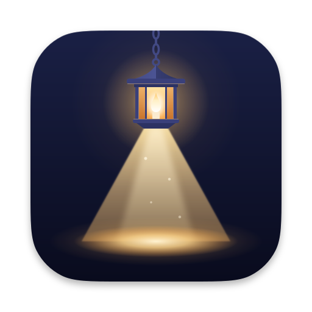
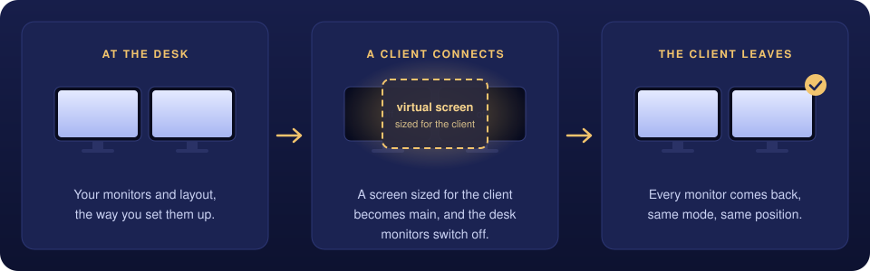
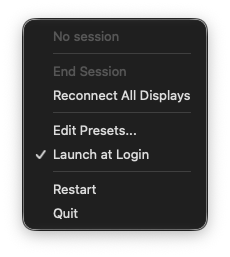
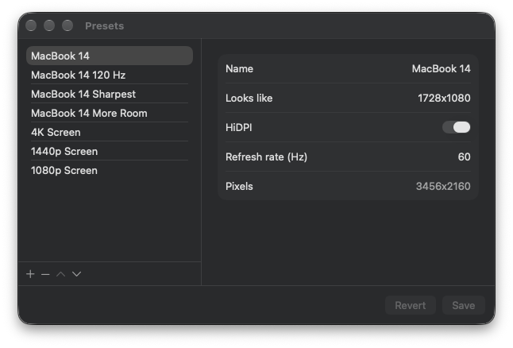

<p align="center">
  
</p>

<h1 align="center">Porch Light</h1>

<p align="center">
  <strong>A screen sized for the device you connect from. The desk dark while you're away. Everything back the way it was when you leave.</strong>
</p>

<p align="center">
  
  
  
  
</p>

---

When you work on a Mac remotely, through Parsec, VNC or any other remote desktop, you get whatever the Mac's main monitor happens to be. The size is wrong for your laptop or tablet, the text is tiny or blurry, and meanwhile the monitors at your desk light up an empty room.

**Porch Light fixes both.** When a remote session starts, it creates a virtual screen at exactly the size of the device you're on, makes it the main display, and turns the desk monitors off. When the session ends, every monitor comes back with its own resolution, refresh rate and position. A guardian process watches the whole time, so a crash never leaves you with a dark desk.

<p align="center">
  
</p>

## Features

- **A screen that fits the client.** Any size from 640x360 to 3840x2400, HiDPI or not, at 24 to 240 Hz. Change it mid-session from the menu bar or the CLI.
- **Monitors off, then back exactly.** Before anything turns off, Porch Light records every monitor's mode, position and main-display status, and it restores from that record.
- **Never a dark Mac.** A guardian LaunchAgent restores the monitors if Porch Light or the app that started the session dies. If restoring keeps failing, it shows an alert window you can see even over a screen share.
- **Presets.** Saved sizes you can add, rename, reorder and edit in a small window, plus an optional preset per client device.
- **Made for automation.** A `porchlight` CLI with JSON output, a versioned session API and a small Swift client library, so other apps can drive sessions.
- **Ready for Parsec.** Scripts in `Scripts/parsec/` start a session when a Parsec guest connects and end it when the last one leaves.

## Screenshots

<p align="center">
  
  &nbsp;&nbsp;
  
</p>
<p align="center"><sub>The menu bar menu, and the Presets window.</sub></p>

## Requirements

- macOS 26 or later, on Apple silicon
- Xcode, with one Apple Development signing identity in your keychain
- [XcodeGen](https://github.com/yonaskolb/XcodeGen): `brew install xcodegen`

## Install

There's no prebuilt download yet, so build it from source. From the repository folder:

```sh
Scripts/bootstrap.sh                       # checks the tools, writes your signing team to a gitignored file
Scripts/gen.sh                             # makes the Xcode project from project.yml
Scripts/build.sh                           # builds and signs build/PorchLight.app
Scripts/install.sh --guardian --link-cli   # installs to /Applications, starts the guardian, links the CLI
```

| `install.sh` flag | What it does |
|---|---|
| `--guardian` | Installs and starts the guardian LaunchAgent. |
| `--link-cli` | Links the CLI to `~/.local/bin/porchlight`. |
| `--end-session` | Ends a live session first, which brings the monitors back. Without it, a live session stops the install, so nobody connected gets cut off. |

To start Porch Light at login, turn on **Launch at Login** in its menu.

## Quick start

```sh
# Start a session: a 1728x1080 HiDPI screen (3456x2160 pixels) becomes main, the monitors turn off.
# Tying it to your shell's PID means the session ends if the shell goes away.
porchlight session start -client=demo -lookslike=1728x1080 -ownerpid=$$

porchlight session resize -lookslike=1920x1200   # a different size, monitors stay off
porchlight session resize -hz=120                # only the refresh rate
porchlight session status

porchlight session end -client=demo              # every monitor comes back
```

The menu bar menu does the same: during a session, pick a size under **Resolution**, a rate under **Refresh Rate**, or choose **End Session**.

<details>
<summary><strong>All session options</strong></summary>

- `session start` makes the virtual screen the main display and turns the monitors off.
  - Defaults: `-client=default -lookslike=1728x1080 -hidpi=on -hz=60`.
  - Width 640 to 3840, height 360 to 2400, refresh rate 24 to 240.
  - `-preset=<name>` uses a saved size instead. `-preset=auto` picks a size for the device that connected over Parsec (see [Use it with Parsec](#use-it-with-parsec)).
  - `-ownerpid=<pid>` ties the session to a process. If any owner exits, the session ends. You can give several.
  - `-keepon=<UUID>` leaves that monitor on.
  - A second start from the same client keeps the current size and adds its owners. A start from another client fails with `session held by <client>`.
- `session resize` changes the size of a running session. It never touches the monitors.
- `session status` prints one line: `state=idle`, or the state, client, screen and size.
- `session presets` lists the saved sizes.
- `session end` brings the monitors back. With no session, it does nothing and succeeds. `-force` ends a session that another client holds.

Every command takes `--json` (one line of JSON), `--no-launch` (fail instead of starting the app) and `--timeout=<seconds>`. Answers go to stdout with exit code 0. Failures print `Failed.` and a reason to stderr, with exit code 1.

</details>

<details>
<summary><strong>Other commands</strong></summary>

```sh
porchlight rescue                                   # end any session, bring every monitor back, even if the app hangs
porchlight get -identifiers                         # every display, as JSON
porchlight get -displayWithMainStatus -resolution -refreshRate
porchlight set -UUID=<display UUID> -pinRefreshRate=120   # always restore this monitor at 120 Hz
porchlight ping
porchlight quit                                     # end any session, then quit
porchlight help
```

</details>

## Presets

Presets are saved sizes. Pick one with `-preset=<name>`, from the **Resolution** menu during a session, or edit them in **Edit Presets...**. They live in `~/Library/Application Support/PorchLight/presets.json`.

<details>
<summary><strong>A preset per device</strong></summary>

Porch Light can pick a preset based on which device connected. Parsec's log gives the connecting device's network address, so you map addresses to presets:

```sh
porchlight clients set -name=Laptop -address=192.168.1.50 -preset="1440p Screen"
porchlight clients auto -on
porchlight session start -client=parsec -preset=auto -ownerpid=$$
```

Mapping by address is off by default. A device with no match gets a screen matched to its own screen size instead (see [Use it with Parsec](#use-it-with-parsec)), and with no usable size, the default size, 1728x1080 HiDPI at 60 Hz. Reserve the device's address in your router so it stays the same. `clients remove -name=<name>` takes a device out.

The settings for devices with no match:

```sh
porchlight clients list                  # the settings, then each mapped device
porchlight clients match -on|-off        # match the screen size the device reports (on by default)
porchlight clients notch -on|-off        # keep a phone's notch in the black bars (on by default)
porchlight clients room -factor=4/3      # a phone's extra room, 1/1 (pixel for pixel) to 2/1 (4/3 by default)
```

They're kept with the mapping, in `~/Library/Application Support/PorchLight/clients.json`.

</details>

## Use it with Parsec

Parsec has no hook for "a guest connected", so a small watcher follows Parsec's log and calls two scripts:

| Script | When | What it does |
|---|---|---|
| `parsec-mode` | A guest connects | Starts a session for the client `parsec`, sized for the device that connected (see below). Its owners are the watcher and Parsec itself, so the session ends if either dies. |
| `desk-mode` | The last guest leaves | Ends the `parsec` session. If that fails, it runs `porchlight rescue`. |

Install them (after `install.sh --link-cli`):

```sh
cp Scripts/parsec/parsec-mode Scripts/parsec/desk-mode Scripts/parsec/parsec-display-watch ~/.local/bin/
sed "s|HOME_DIR|$HOME|g" Scripts/parsec/com.alexluncan.parsec-display.plist \
  > ~/Library/LaunchAgents/com.alexluncan.parsec-display.plist
launchctl bootstrap gui/$(id -u) ~/Library/LaunchAgents/com.alexluncan.parsec-display.plist
```

**How `parsec-mode` picks the size:** it starts the session with `-preset=auto`, and Porch Light chooses:

1. A device you've mapped by address (see [A preset per device](#presets)) gets its preset.
2. Any other device gets its own screen size. When a device connects, the Parsec client sends its screen size, and Parsec saves it in `~/.parsec/config.json`. Porch Light turns it landscape and makes a HiDPI screen at half of it, so the stream is sharp and fills the device. This works from anywhere, including over cellular.
3. A phone (a screen wider than 2:1, with a notch or Dynamic Island) gets a slightly narrower screen, 28:15. The client adds black bars at the sides, and those land under the notch, so nothing is hidden. Then it gets 4/3 more room, which the client scales down to fit. An iPhone 17 Pro gets 1500x804. With `clients room -factor=1/1` it gets 1125x603, pixel for pixel, and with `clients notch -off` the full width as well, 1311x603.
4. With no usable size, or with `clients match -off`, it uses the default size.

Parsec doesn't always save the size again when it hasn't changed. Then Porch Light waits up to 3 seconds for it, and uses the size saved before, most likely the same device's. `~/Library/Logs/PorchLight/session.log` says which rule chose each size, and when the size it used was saved. A device whose client doesn't send its size gets the last size another device sent, so map such a device by its address. Clients that send their screen size include [OpenParsec](https://github.com/hugeBlack/OpenParsec) with its Resolution setting on "Client Resolution". Whether the official Parsec app does isn't checked yet.

`parsec-mode --dry-run` prints the command it would run without starting anything. The watcher logs to `~/Library/Logs/parsec-display.log`.

## If a screen goes dark

Use the first one you can:

1. **On the Mac:** run `porchlight rescue`.
2. **From another computer, over SSH:** `ssh <your-mac> /Applications/PorchLight.app/Contents/Helpers/porchlight rescue`
3. **On the Mac's keyboard:** press **Control+Option+Command+Escape**. (Control+Option+Command+Q quits Porch Light, which also ends the session. Control+Option+Command+R restarts it and *keeps* the session, so it's not a way back.)
4. **With Parsec:** disconnect. The watcher runs `desk-mode`, which ends the session.

If a monitor comes back and goes off again within a few seconds, run the rescue again. If nothing works, wait a minute (the guardian retries on its own every 60 seconds), or restart the Mac: a monitor turned off by software always comes back after a restart. With FileVault on, someone has to type the password at the Mac after that restart.

## How it stays safe

- **The record comes first.** Before any monitor turns off, Porch Light writes down every monitor's ID, mode, position and whether it was main, in `~/Library/Application Support/PorchLight/safety.json`. Every restore works from that record.
- **Never zero displays.** Porch Light refuses any change that would leave the Mac with no working display. Only a session can turn every monitor off, because then the virtual screen is on and the guardian is watching.
- **The guardian.** `porchlight-guardian` is a LaunchAgent that checks the session four times a second.
  - If Porch Light dies mid-session, the guardian relaunches it and the session picks up again.
  - After 2 relaunches without 5 healthy minutes between them, or an app that isn't healthy within 10 seconds, it restores the monitors instead.
  - If a session's owner dies, it asks Porch Light to end the session, and restores the monitors itself after 8 seconds if that hasn't happened.
  - An app that stops answering for 15 seconds is stopped and treated as dead.
- **The alert window.** If restores keep failing, the guardian posts a notification. macOS hides notification banners during a screen share, so it also shows a window above everything else with the rescue commands. It closes itself after 10 minutes.

Logs are in `~/Library/Logs/PorchLight/`: `session.log` for sessions and `guardian.log` for the guardian. `Scripts/logs.sh` follows both.

## For developers

### Driving Porch Light from another app

Other apps, such as a custom remote desktop host, can run sessions through the CLI or the Swift library `PorchLightClient` in this package. The contract is session API version 1: [`docs/session-api.md`](docs/session-api.md).

```sh
porchlight session start -client=my-tablet -lookslike=1180x820 -ownerpid=<your PID> --json
porchlight session status --json     # includes the virtual screen's displayID and displayUUID
porchlight session watch --json      # one line per change, until the app goes away
```

- Pass your own process ID as `-ownerpid`, so the session ends if your app dies.
- The `displayID` changes whenever the screen is made again, for example after Porch Light relaunches. Capture the `displayID` from the latest status, and use `displayUUID` (stable per client name) to recognize the screen.
- `com.alexluncan.PorchLight.sessionChanged` is posted after every change, and `com.alexluncan.PorchLight.launched` when the app is ready after a launch.
- In Swift, `PorchLightClient` offers `start`, `end`, `status()` and `changes()`.

### Building and testing

```sh
swift build && swift test        # no hardware involved
Scripts/lint.sh                  # repository rules
AD_DRY_RUN=1 ...                 # reads the real displays but changes nothing
Scripts/dryrun-session.sh        # a whole session in dry-run mode
Scripts/release.sh               # the signed, notarized installer (needs Developer ID certificates)
```

All the logic lives in SwiftPM targets in `Sources/`, so it builds and tests without Xcode. The app target in `App/` is only lifecycle glue. What's next is in [`docs/roadmap.md`](docs/roadmap.md).

## Works alongside BetterDisplay

Porch Light only handles remote sessions. It's happy to share the Mac with BetterDisplay or any other display utility for everyday work. Porch Light is an independent project, built only on Apple's macOS APIs and public documentation, and isn't affiliated with BetterDisplay or its developer.

## Name

Porch Light was called **Amazing Displays** during early development. That's where the `AD` prefix on module names and environment variables comes from.

## License

[MIT](LICENSE). Third-party code and its notices are in [`THIRD_PARTY_NOTICES.md`](THIRD_PARTY_NOTICES.md).
